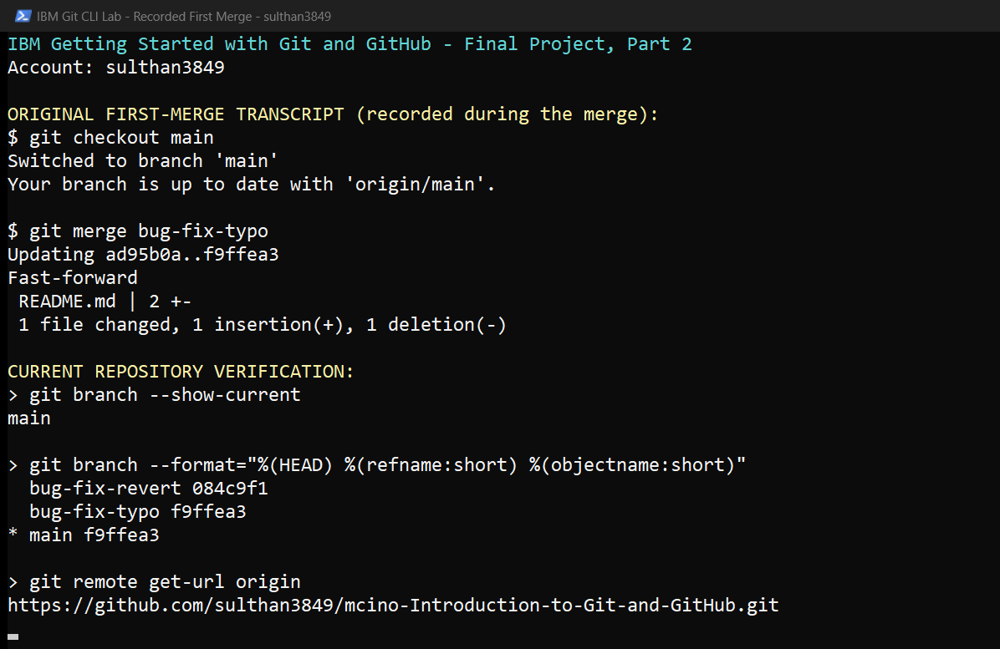

# Option 2 — Peer Review Submission

Copy each field below into the matching field in **My submission**. For URL fields, paste the URL only. For text fields, paste the full paragraph and its supporting link.

## Project Title

Simple Interest Calculator — Git and GitHub Final Project

## Part 1 Task 1 — URL

https://github.com/sulthan3849/github-final-project

## Part 1 Task 2 — Text

The repository contains a file named LICENSE in its root directory. It contains the complete Apache License, Version 2.0, including definitions, copyright and patent grants, redistribution, submission of contributions, trademarks, warranty disclaimer, limitation of liability, and acceptance of additional liability. GitHub also identifies the repository license as Apache-2.0. The full license is publicly accessible at the following link.

https://github.com/sulthan3849/github-final-project/blob/main/LICENSE

## Part 1 Task 3 — Text

The repository contains README.md in its root directory. It introduces the Simple Interest Calculator and describes the required inputs: principal amount, annual interest rate as a percentage, and duration in years. It states the formula, simple interest = principal × rate × time / 100, and includes requirements, execution instructions, an example calculation, acceptance checks, contribution links, and license information.

https://github.com/sulthan3849/github-final-project/blob/main/README.md

## Part 1 Task 4 — Text

The repository contains CODE_OF_CONDUCT.md in its root directory. It uses the Contributor Covenant and includes Our Pledge, Our Standards, Enforcement Responsibilities, Scope, Enforcement, Enforcement Guidelines, and Attribution. The document explains expected and unacceptable behavior, the responsibilities of community leaders, and the consequences of violations. It also identifies the source of the code of conduct and its enforcement guidance.

https://github.com/sulthan3849/github-final-project/blob/main/CODE_OF_CONDUCT.md

## Part 1 Task 5 — Text

The repository contains CONTRIBUTING.md in its root directory. It explicitly states that all contributions, bug reports, bug fixes, documentation improvements, enhancements, and ideas are welcome. This contribution statement covers both code changes and non-code improvements, including documentation and suggestions. The file is publicly accessible, so reviewers and prospective contributors can read the contribution statement directly at the following link.

https://github.com/sulthan3849/github-final-project/blob/main/CONTRIBUTING.md

## Part 1 Task 6 — Text

The repository contains simple-interest.sh in its root directory. This Bash script prompts the user for the principal amount, annual rate of interest as a percentage, and time period in years. It calculates simple interest using principal × rate × time / 100 and prints the result to two decimal places. It accepts non-negative whole numbers and decimals, rejects invalid or incomplete input, and passes the included acceptance checks.

https://github.com/sulthan3849/github-final-project/blob/main/simple-interest.sh

## Part 2 Task 1 — URL

https://github.com/sulthan3849/mcino-Introduction-to-Git-and-GitHub

## Part 2 Task 2 — Upload File

Upload **merge_branches.png** using **Add File**.

[Download the PNG](https://raw.githubusercontent.com/sulthan3849/github-final-project/main/evidence/merge_branches.png)

This is a genuine screenshot of a native PowerShell console displaying the original saved first-merge transcript, followed by live repository verification. It shows `git checkout main`, `git merge bug-fix-typo`, the README change, `1 file changed`, the active `main` branch, and the fork URL.

## Part 2 Task 3 — URL

https://github.com/ibm-developer-skills-network/mcino-Introduction-to-Git-and-GitHub/pull/13710

## Part 2 Task 4 — URL

https://github.com/sulthan3849/mcino-Introduction-to-Git-and-GitHub/branches

## Pull request status

The linked pull request targets the IBM course repository's `main` branch from `sulthan3849:bug-fix-revert`. The IBM lab bot closed it automatically and posted a completion message. Its status is closed and unmerged. The lab bot's comment is [available on the PR](https://github.com/ibm-developer-skills-network/mcino-Introduction-to-Git-and-GitHub/pull/13710#issuecomment-6997527099).

This package prepares the submission artifacts. It does not record submission to the course website or completion of any peer reviews.
